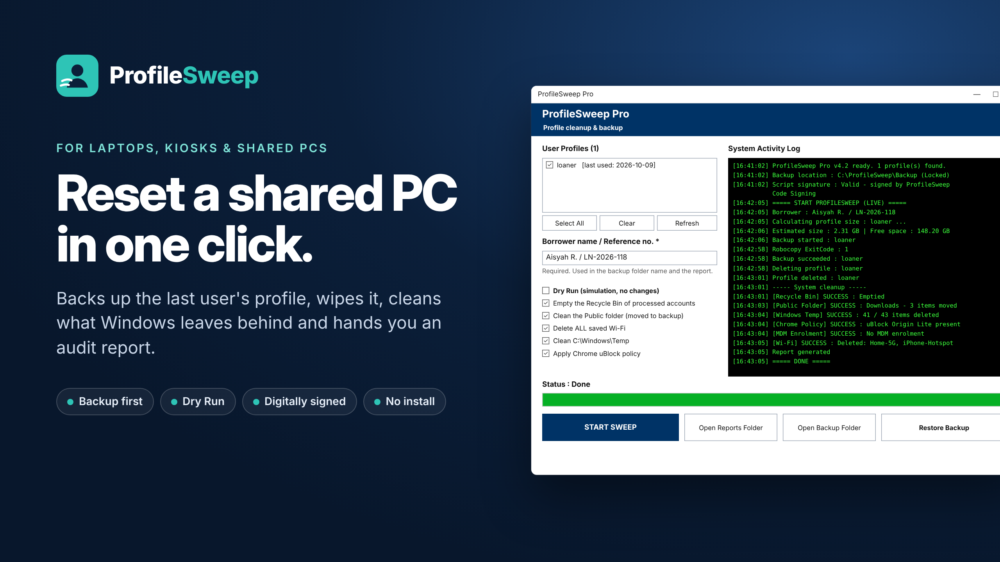

# ProfileSweep Lite

**Reset shared Windows PCs in one click.** Safely back up and remove old local user profiles from loaner laptops, meeting-room PCs, labs and kiosks.

---

## The problem

Shared Windows PCs collect dozens of old user profiles. Each one can be gigabytes of cache, downloads and browser data. Disks fill up, logins slow down, and cleaning them by hand through *System Properties → User Profiles* is slow and easy to get wrong.

## What ProfileSweep Lite does

- **Lists** every local profile with its last-used date, and flags profiles whose account was deleted
- **Backs up** selected profiles with Robocopy and verifies the copy before deleting
- **Removes** profiles cleanly (registry entry + folder), not just the folder
- **Protects** the current user, built-in Administrator and every member of the local Administrators group
- **Skips** orphaned profile records that share a folder with another profile, so a live user's data is never touched
- **Empties** the Recycle Bin of processed accounts (optional)
- **Dry Run** mode to simulate everything with no changes
- **HTML audit report** after every run
- Code-signed script, simple GUI, no command line needed

Runs 100% offline. No telemetry, no account, nothing leaves the machine.

## Requirements

- Windows 10 or 11
- Windows PowerShell 5.1
- Administrator rights

## Quick start

1. Download `ProfileSweep_Lite_v4.2.1.zip` from the [Releases](../../releases) page and extract it.
2. Right-click `Run_ProfileSweep.bat` → **Run as administrator**.
3. Tick **Dry Run** first and click **START SWEEP** to see what would happen.
4. When you're happy, untick Dry Run, select the profiles to clean and run it for real.

Optional: edit `ProfileSweep.settings.json` (Notepad) to set `TargetAccounts` (e.g. `["loaner"]`) and `ProtectedAccounts` (your technician accounts).

> ⚠️ **Test on a non-production PC first.** ProfileSweep deletes user data. The built-in backup is a safety net, not a replacement for your own backups.

## Lite vs Starter vs Pro

| Feature | Lite (free) | Starter | Pro |
|---|:---:|:---:|:---:|
| Live cleanups per computer | 10 | Unlimited | Unlimited |
| Backup + delete, Dry Run, HTML report | ✅ | ✅ | ✅ |
| Admin protection, folder lock, Recycle Bin cleanup | ✅ | ✅ | ✅ |
| Borrower names + CSV audit log | — | ✅ | ✅ |
| Restore backup, automatic backup retention | — | ✅ | ✅ |
| Public folders, Wi-Fi profiles, Windows Temp cleanup | — | ✅ | ✅ |
| Auto mode (Task Scheduler) for meeting-room PCs | — | — | ✅ |
| Chrome extension policy, MDM check | — | — | ✅ |
| Backup to network share / external drive | — | — | ✅ |

**Need unlimited cleanups or audit logs?** → [Get Starter or Pro](https://profilesweep.gumroad.com)

## License

ProfileSweep Lite is free for personal and commercial use. Redistribution of modified copies is not permitted.

## Feedback

Found a bug or have an idea? [Open an issue](../../issues). Stars ⭐ help other admins find the project.
